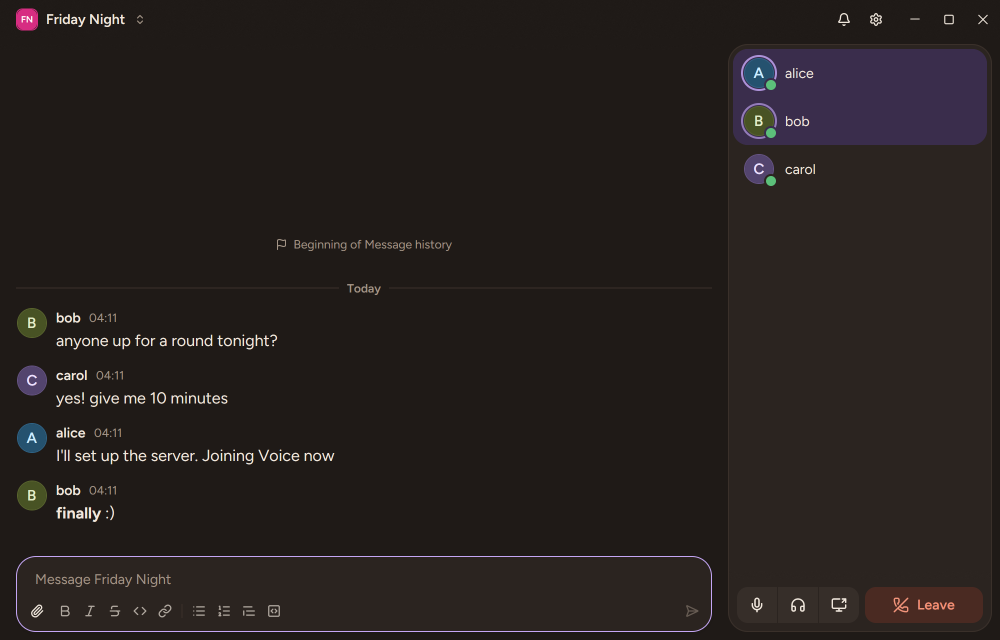

# Lobby

Lobby is a self-hosted chat, Voice and Screen Share app for a small group of friends. One of you
runs a server for the group, and everyone connects to it from the Lobby desktop app.



- Chat with Markdown, images and attachments.
- Voice, with a speaking indicator for each Member.
- Screen Share, which anyone in the Lobby can watch.
- Sign in with a Magic Code sent by email; there are no passwords. New people ask to join, and a
  Member lets them in.

Everyone in a Lobby sees everything in it. There are no channels and no roles besides the owner.

## Install the app

The app runs on Windows 10 and 11, and on Linux (see [Linux](#linux) below).

1. Download `LobbySetup.exe` from the [latest release](../../releases/latest).
2. Run it. It installs Lobby for your Windows user into `%LOCALAPPDATA%\Programs\Lobby`, with no
   administrator prompt, and adds it to the Start menu and the desktop. The exe is not code-signed
   yet, so Windows SmartScreen may ask first: choose **More info**, then **Run anyway**.
3. Enter the address of your group's Lobby, then your email.

Lobby updates itself. When a new release is out, the title bar shows its download, then
**Restart to update**. If you quit instead, the update is in place the next time you start Lobby.
To uninstall, use **Installed apps** in Windows Settings. Your Lobbies and settings stay.

### Linux

The app runs on 64-bit (x86_64) Linux with glibc 2.39 or newer (Ubuntu 24.04 and later) and a
Wayland desktop session (GNOME, KDE, sway and the others; X11 is not supported). Ubuntu is the
tested system. Chat and Voice work as on Windows. Sharing your screen and watching a Screen Share
are not available on Linux yet. Download
`install.sh` from the
[latest release](../../releases/latest) and run it with `sh install.sh`. It downloads the app,
checks it, and the app installs itself for your user into `~/.local/share/lobby`, adds Lobby to
your launcher and opens `lobby://` links. Updating works as on Windows. To uninstall, run
`~/.local/share/lobby/lobby --uninstall`. Your Lobbies and settings stay.

## Host a Lobby

A Lobby is one server, `lobby-server`, behind Caddy for TLS. It runs with Docker Compose on a
small Linux VPS or a home server. Each release publishes the image
`ghcr.io/frisksitron/lobby-server`. You need a domain name and an SMTP provider for the Magic
Code emails.

[deploy/README.md](deploy/README.md) walks through a fresh server, backups, upgrades and the
bandwidth that Voice and Screen Share need.

## What Lobby protects, and what it does not

Lobby puts its security work into who gets in: sign in, Magic Codes, admission, sessions, rate
limits and TLS. It does not encrypt data at rest and has no end-to-end encryption. Whoever runs
the server can read the Messages and files, and the server relays Voice and Screen Share. Host
Lobby for people who trust the person running it.

To report a vulnerability, see [SECURITY.md](SECURITY.md).

## Release

`cargo xtask release <version>` bumps the version, commits, tags `v<version>` and pushes. The tag's
[release workflow](.github/workflows/release.yml) builds `LobbySetup.exe` and the server image and
publishes the GitHub Release. Every installed app sees it within the hour.

## Develop

You need Rust (the version in `rust-toolchain.toml`), cmake on `PATH`, and on Windows the
MSVC build tools. For Magic Code email, run a local SMTP sink such as
[Mailpit](https://mailpit.axllent.org/) on port 1025, or set `log_codes = true` under `[smtp]`
in `lobby.toml` to read each code in the server's log instead. `log_codes` works only in a debug
build, for a server that binds a loopback address and has no `trusted_proxy_cidrs`.

1. Set `auth.bootstrap_email` in `lobby.toml` to your email address. The first person to sign in
   with that address becomes the Lobby's first Member and its owner.
2. Start the server:

   ```sh
   cargo run -p lobby-server
   ```

3. Start two desktop clients. Each `LOBBY_INSTANCE_ID` keeps its own data and tokens.

   ```sh
   LOBBY_INSTANCE_ID=a cargo run --bin lobby
   LOBBY_INSTANCE_ID=b cargo run --bin lobby
   ```

4. Type `localhost:8080` and press Connect.

The component gallery shows every desktop component in its states. Pass a story name, such as
`MemberRow`, to open on that page:

```sh
cargo run -p lobby-desktop --features gallery --bin lobby-gallery [story]
```

To drive the desktop app headlessly and capture proof of a UI change, see
[.claude/skills/verify/SKILL.md](.claude/skills/verify/SKILL.md).

[AGENTS.md](AGENTS.md) holds the project rules. Run `cargo xtask gates` before you send a change.
A change you send for inclusion in Lobby is licensed like the rest of it.

## License

Lobby is licensed under the [GNU Affero General Public License v3.0](LICENSE). Anyone may use,
change and host it; whoever runs a changed Lobby server for others must offer those users its
source. Each release ships `THIRD-PARTY-NOTICES.html` with the licences of the crates the
app is built from. The bundled Figtree font is under the SIL Open Font License 1.1
([crates/lobby-desktop/fonts/OFL.txt](crates/lobby-desktop/fonts/OFL.txt)).
