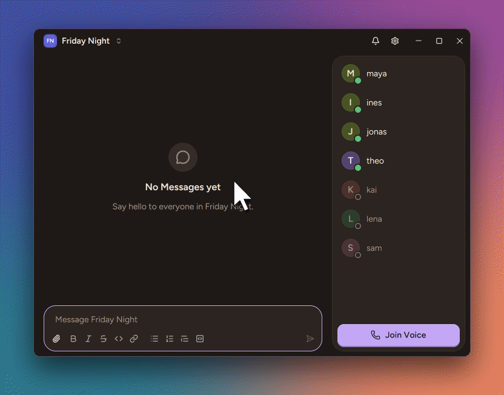

# Lobby

Chat, voice and screen share for a group of friends, on a server you host yourselves.



Lobby is made for a few friends who already know each other. Everyone is in one room and sees the
same things, so there are no channels to organize and no roles to hand out. One of you runs the
server, so your chat stays on a machine you control. To sign in, you type your email and Lobby
sends you a one-time sign-in code.

## Install

**Windows 10 or 11.** Download and run
[LobbySetup.exe](https://github.com/frisksitron/lobby-rs/releases/latest/download/LobbySetup.exe).

**Linux.**

```sh
curl -fsSL https://github.com/frisksitron/lobby-rs/releases/latest/download/install.sh | sh
```

It needs x86_64, Wayland and glibc 2.39 or newer (Ubuntu 24.04 and later). Screen share does not
work on Linux yet.

The app updates itself. To uninstall, use **Installed apps** on Windows, or run
`~/.local/share/lobby/lobby --uninstall` on Linux.

## Host a server

You need a Linux machine with Docker, a domain name and an SMTP account for the sign-in emails.
The [deployment guide](deploy/README.md) has the steps.

## Privacy

Everything is encrypted on its way between the apps and the server. There is no end-to-end
encryption. That keeps Lobby simple, and the group shares one chat that everyone reads anyway. It
does mean that whoever runs the server can read along and listen in, so host it for people who
trust you.

To report a vulnerability, see [SECURITY.md](SECURITY.md).

## Develop

You need the Rust version in `rust-toolchain.toml` and cmake. On Windows, add the MSVC build tools.
On Linux, add the [packages that CI installs](.github/workflows/ci.yml).

In `lobby.toml`, set `auth.bootstrap_email` to your email and add `log_codes = true` under
`[smtp]`. Then start the server and the app, each in its own terminal:

```sh
cargo run -p lobby-server
```

```sh
cargo run --bin lobby
```

Connect to `localhost:8080`. The sign-in code is in the server's log. To run a second app beside
the first, set `LOBBY_INSTANCE_ID` to another name.

[AGENTS.md](AGENTS.md) has the project rules. Run `cargo xtask gates` before you send a change.

## License

[AGPL-3.0](LICENSE). If you run a changed server for other people, you must offer them its
source. Each release ships the licences of its dependencies in `THIRD-PARTY-NOTICES.html`. The
Figtree font is under the [SIL OFL 1.1](crates/lobby-desktop/fonts/OFL.txt).
